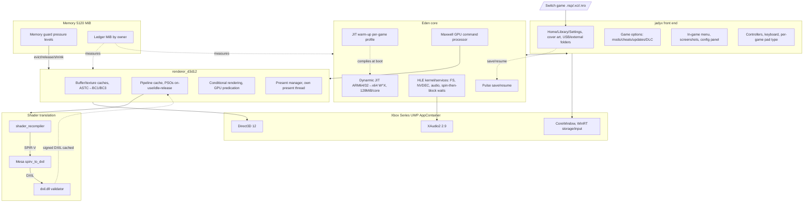

<!--
SPDX-FileCopyrightText: Copyright 2026 Eden Emulator Project
SPDX-License-Identifier: GPL-3.0-or-later
-->

<p align="center"></p>
<h1 align="center">Jadyx</h1>
<p align="center">Nintendo Switch emulator for <b>Xbox Series X|S (Dev Mode)</b> and <b>Windows PC</b>, based on Eden, with a <b>native Direct3D 12 renderer</b>.</p>
<p align="center"><a href="https://github.com/vvarcos/jadyx/releases/latest"><b>Download</b></a> · <a href="https://discord.gg/3BhyyXGxpd"><b>Discord</b></a> · <a href="https://github.com/vvarcos/jadyx/issues/new/choose"><b>Report bug</b></a></p>
<p align="center"><br><sub>Home screen. Games shown are made-up placeholders with original artwork.</sub></p>
<p align="center"><br><sub>In-game quick menu (hold View+Menu).</sub></p>

> **Beta.** Some games reach gameplay; none bug-free. No keys/firmware/games included—use only your own dumps. See [Legal](#legal).

> **Experimental fork of [JulianDr14/jadyx](https://github.com/JulianDr14/jadyx).** All credit for Jadyx (UWP port, D3D12 renderer, front end, docs) goes to **JulianDr14**. This fork tracks his `main` and adds a few changes (one per commit): see [What this fork adds](#what-this-fork-adds). Not an official release; do not report its problems upstream.

> **AI-assisted development.** Code, docs and reports drafted with AI under my direction, then reviewed/built/tested. Unverified-on-console items are noted.

**Contents:** [What this fork adds](#what-this-fork-adds) · [Progress](#progress) · [Architecture](#architecture) · [Console](#running-it-on-a-console) · [Building](#building) · [Docs](#documentation) · [Acknowledgements](#acknowledgements) · [Legal](#legal) · [License](#license)

## What this fork adds

Rebased on Jadyx 0.3.8.5, one change per commit:
- **Mii editor openable by hand.** `MiiEdit` is Nintendo's applet; now a **Mii editor** row in Settings > System + `boot.cfg applet=mii_edit` switch launches it standalone; library regains control on close. Needs composite below + firmware imported with applet.
- **Whole layer stack composited.** Switch display can deliver several layers (game + applet); only bottom was presented. Now drawn back-to-front with per-blend-mode pipeline.
- **Firmware import tolerates game files.** Mixed folders no longer refused; game NCAs dropped, firmware installs. Picked files never modified (staged copy drops them).

Brazilian Portuguese catalogue and pipeline prewarm now part of Jadyx itself. Non-upstream changes documented in [docs/xbox/](docs/xbox/README.md).

## Progress

### Games
Tested with owned dumps on retail Series X|S in Dev Mode, app in Game mode. Figures after shaders compiled; new areas still stutter. *community* = Discord `#compatibility` reports.

| Game | Console | Performance | Notes |
|---|---|---|---|
| Mario Kart 8 (32-bit) | X | **60 FPS** races | No gfx errors; 16.7ms frames, 17.1ms worst mid-race |
| Mario Kart 8 (community) | X | **50–60 FPS** | Jadyx 0.3.0.0 |
| Mario Strikers | X | **60 FPS** matches | GPU 14% |
| Pokémon Let's Go | X | **60 FPS** | No gfx errors |
| Mario Wonder | X | **55–60 FPS** | No crashes/gfx errors |
| Mario Wonder (community) | S | **60 FPS** | |
| Under Night In-Birth II (community) | S | **60 FPS** | |
| Naruto x Boruto (community) | S | **30 FPS** stable | |
| Mario 3D World | X | **60 FPS** | |
| Hades II (community) | S | **60 FPS** smooth | 0.3.8.0 |
| Bayonetta (community) | S | **60→42 FPS** combos | 0.3.8.0 |
| Bayonetta 2 (community) | S | **60→30–40 FPS** heavy | 0.3.8.0 |
| Super Mario Odyssey | X | **45–50 FPS** open, **60** enclosed | |
| 13 Sentinels (community) | X | **60 FPS** | Playable |
| NEO TWEWY (community) | X | **20–30 FPS** (50 menus) | 10–17 during shader compile |
| Pokémon Sword (community) | S | **20–30 FPS** | ~1s stutters (shader compile?) |
| Yo-kai Watch 4++ (community) | S | **30 FPS** menus, **20** open world | 0.3.5 gets past white screen |
| Hyrule Warriors AoC (community) | X | **30 FPS** cutscenes | 0.3.5 gets in-game |
| BotW | X | **27–29 FPS** open world | Holds 30 in lighter areas |
| TotK | X | Renders clean then **hits memory wall** | See [memory wall](#the-memory-wall); PC open world 30 FPS |

Hades II/Bayonetta Series S inferred from tester's other reports. Open-world frame loss: GPU thread spends ~32ms host CPU recording ~4000 draws/frame (~8µs/draw) vs GPU ~8ms. Audio works in all tested; none played start-to-finish, so none "fully playable".

### Subsystems

| Part | How | Notes |
|---|---|---|
| Renderer | Own D3D12 backend, modelled on Eden Vulkan | FL 11.0, SM 6.4, no Agility SDK. See [Inside renderer](#inside-the-renderer) |
| Guest shaders | Eden recompiler→SPIR-V; Mesa `spirv_to_dxil`→DXIL; `dxil.dll` signs | Cached per game, rebuilt parallel at boot; integer textures→texel fetches |
| Pipelines | Keep DXIL; PSO built on draw, released when idle | Recent sessions' pipelines built at boot (`d3d12_hot.bin`); share stage bindings |
| Conditional rendering | GPU `SetPredication` | No per-frame query waits |
| CPU | Dynarmic JIT, W^X in AppContainer, 64/32-bit | 128 MiB cache/core (`jit_cache_mib`); per-game warm-up profile. See [JIT warm-up](#the-jit-warm-up) |
| Emulated cores | Spin briefly then block | Skip ~40µs OS wake latency |
| Guest memory | Placeholder `*FromApp`, committed on demand; fiber stacks grow | No fastmem; page table per access |
| App memory | Memory guard + ledger | See [memory guard](#the-memory-guard)/[wall](#the-memory-wall) |
| Textures | ASTC→BC3 on GPU (BC1 if no alpha); arrays included | `astc=bc3` CPU path; `astc_opaque=bc3`; `astc_arrays=rgba` |
| Audio | XAudio2 2.9 | Same PC/Series |
| Front end | Home/Library/Settings; cover art cached; full-screen in-game menu | EN/ES/PT-BR; games/keys/fw via Portal or folder/ZIP/USB. See [front end](#the-front-end) |
| Game options | Mods/Cheats/Updates/DLC/Pulse per game | Cheats changeable while playing. See [Game options](#game-options) |
| Mods | Priority order; GameBanana/CNX or disk archives | .zip/.7z/.rar; multi-variant archives pickable. See [Mods](#mods) |
| Cheats | Atmosphere cheats + nx-cheats-db | See [Cheats](#cheats) |
| Updates/DLC | NSP/XCI, verified, internal or USB in-place | Multiple versions, one active. See [Updates and DLC](#updates-and-dlc) |
| Input | Xbox pads, PC keyboard (rebindable) | Per-game emulated pad type; no silent pad replacement; held directions repeat |
| Recovery | GPU failure→library | Still validating on Series |
| Pulse | Back to home saves; pick resumes | 64/32-bit save/resume on Series+PC. See [Pulse](#pulse-resume-where-you-left-off) |

### The memory wall

Heaviest game draws correctly but OOMs in heaviest loads: renderer can't create buffer → returns to library.

**Why:** Game mode = 5120 MiB total, GPU shares it. Switch gives game ~3.2 GiB, uses almost all. Emulator needs JIT, shaders/pipelines, and a second copy of every texture (game textures in emulated mem; GPU needs own format). On PC second copy goes to VRAM; on Series counts vs same 5120 MiB.

PC measured (no limit) in failing load:

| What | MiB | Shrinkable? |
|---|---|---|
| Emulated Switch memory | 2460 | No |
| Textures on GPU | 1000 live (up to 2000 unbounded) | Evict sooner / lower res |
| Emulator C++ heaps | 750 | Partly (~400 MiB unattributed) |
| Other GPU (upload ring, buffers) | 460 | Already cut |
| JIT code cache | 300–400 | Capped 128 MiB/core |
| Executable+DLLs | 200 | No |

Without textures ~4.25 GiB → ~870 MiB for textures under limit; failing load keeps ~1000 MiB. Peak ~6.4 GiB unbounded.

**Cut so far:** PSOs built on draw/released when idle (~100 KiB each, 1.3 GiB/17k pipelines); pipeline stage bindings shared (160→26 MiB/15k pipelines); JIT cache capped 128 MiB/core + compact metadata; fiber stacks 64 KiB grow-on-demand (vs 4 MiB, ~500 MiB/126 fibers); ASTC arrays→BC3 (650→~162 MiB/121 layers); descriptor tables sized to game limit; fonts loaded once; upload ring ≤128 MiB; eviction starts at 768 MiB free; refused allocs retried after reclaim; alpha-less ASTC→BC1.

**Next:** attribute ~400 MiB large heap blocks; optional texture resolution lowering.

Fastmem impossible in Xbox sandbox (W^X); every guest access uses page table. This game is CPU-heavy; Series FPS still unknown.

## Architecture

One UWP executable; the same package runs on **Xbox Series X|S** and on **PC (Windows)** — changes are tried on PC first.



Paths:

| Path | What |
|---|---|
| `src/jadyx/` | Front end: boot (`app/`), library+cache (`library/`), in-game menu (`game/`), settings, i18n (`i18n/locales/`), input (`input/`), UI/tokens (`ui/`), import/storage (`storage/`), diag |
| `src/jadyx/mods/`,`cheats/`,`content/` | Mods manager+store, cheats, updates/DLC manager |
| `src/dynarmic/` | JIT, W^X, warm-up profiles, compact block metadata |
| `src/common/` | Memory ledger, spin-then-block wait, grow-on-demand fiber stacks, Pulse archive format |
| `src/core/pulse_*` | Pulse capture/restore of guest process + HLE service state; sessions in `src/jadyx/pulse_sessions.*` |
| `src/video_core/renderer_d3d12/` | D3D12 renderer (see [Inside renderer](#inside-the-renderer)) |
| `src/shader_recompiler/` | Eden shader recompiler with D3D12 profile tweaks |
| `tools/xbox/mesa/` | Additions to Mesa `spirv_to_dxil` (pipeline linking, integer sampling) |
| `tools/xbox/` | Build/package/run/Mesa/symbolication scripts |
| `tools/xbox/tests/` | Standalone pure-policy tests (memory guard, PSO residency, JIT warm-up, controllers, library, langs, settings, keyboard, cheats, mods) |
| `dist/uwp/` | Manifest + package assets |

Runtime DLLs from package root: `spirv_to_dxil.dll` (Mesa, built by `tools/xbox/build-spirv-to-dxil.ps1`) and `dxil.dll` (Windows SDK). Missing either → CPU present fallback.

### Inside the renderer

`renderer_d3d12` follows Eden's Vulkan backend layout. Generic templates (`TextureCache`,`BufferCache`,`ShaderCache`,`FenceManager`), Vulkan `StateTracker`/`FixedPipelineState` shared; D3D12 supplies runtimes.

| Area | Files | What |
|---|---|---|
| Device/submission | `d3d12_device`, `d3d12_scheduler`, `d3d12_fence_manager`, `d3d12_query_cache` | Device, queue, command lists/allocators, GPU ticks, deferred releases, guest fences/queries |
| Presentation | `renderer_d3d12`, `d3d12_present_manager`, `d3d12_swapchain`, `d3d12_present_blit`, `d3d12_present_cpu`, `d3d12_overlay` | Composite per frame into own texture; dedicated thread copies to swapchain/presents |
| Draws | `d3d12_rasterizer*`, `d3d12_accelerate_dma`, `d3d12_maxwell_to_d3d12`, `d3d12_indirect_buffer`, `d3d12_conditional_rendering` | Draw state, clears, DMA, indirect draws for ExecuteIndirect, predication |
| Pipelines | `d3d12_graphics_pipeline`, `d3d12_compute_pipeline`, `d3d12_root_signature`, `d3d12_stage_bindings`, `d3d12_pipeline_residency` | PSOs/root args, shared stage bindings, residency |
| Shaders | `d3d12_pipeline_cache`, `d3d12_shader_compiler`, `d3d12_linked_shader_cache` | SPIR-V→DXIL on workers, per-game disk cache, linked shader reuse |
| Textures | `d3d12_texture_cache`, `d3d12_image_*`, `d3d12_depth_stencil_transfer`, `d3d12_astc_gpu_decoder`, `d3d12_sampler`, `d3d12_framebuffer`, `d3d12_texture_formats` | Images/views/uploads/downloads/copies/blits/ASTC |
| Helper shaders | `d3d12_blit_image`, `d3d12_blit_compute` | Blits, masked clears, DS packing, ASTC/BC1/BC3 encode |
| Memory | `d3d12_buffer_cache`, `d3d12_staging_buffer_pool`, `d3d12_transfer_buffer_pool`, `d3d12_resource_allocator`, `d3d12_heap_packing`, `d3d12_gc_readback`, `d3d12_memory_guard`, `d3d12_cache_policy` | Buffers, upload ring, scratch, placed heaps/packing, guard/pressure |
| Binding | `d3d12_descriptor_heap`, `d3d12_barrier_batch`, `d3d12_pipeline_helper`, `d3d12_resource_utils` | Descriptor/sampler heaps, batched barriers, helpers |
| Diagnostics | `diagnostics/` | Draw trace, frame dumps, perf report, pipeline/ASTC checks (off hot path) |

**Presentation.** GPU thread composites into one of 3 own textures and submits. Separate `D3D12Present` thread waits on swapchain frame-latency waitable object, copies to back buffer, presents (GPU thread never waits for display). Both submit to same queue under one lock (`Present`+`ExecuteCommandLists` race can deadlock). Without waitable swapchain or `async_present=0` in `boot.cfg`, presentation runs on GPU thread.

### The JIT warm-up

**Problem:** Dynarmic translates Switch ARM64→x64 first run. On PC hidden; in Xbox sandbox each compile flips pages W^X (mandatory) and cores slower → freezes in first minutes/new areas.

**What:** Remembers code a game runs, compiles before game starts:
1. While playing, each emulated core records compiled blocks: guest addr, length, hash of ARM64. No host code stored.
2. On exit saved per game/core/build (`LocalState\jadyx\cache\jit-profile\<title-id>\core-N.bin`), temp file + rename (crash-safe).
3. Next launch, before guest runs, cores replay profiles in parallel, own JIT, budget of emitted code. Loading screen shows progress. Budget learned per game: 64 MiB/core default, then 32/16. Session free<256 MiB lowers next step; long session always ≥1 GiB free raises back. Full profile at 115 MiB/core used to cost 1 GiB of limit.
4. Learning continues during play.

**Safety:** Profile is hint only. Block must be in executable non-writable memory game loaded; instructions must match hash+length. Wrong game/update/core/bad checksum → discarded, core relearns. Failed checks → normal compile when game reaches it. W^X + invalidation stay; warm-up never runs guest code or changes guest state.

**Result:** PC preload time ~halved. On by default; `jit_prewarm=0` off, `jit_prewarm=record` only learns.

Compare: Ryujinx PPTC caches translated host code on disk; this stores only *what* to compile and recompiles each launch—costs boot time, but nothing executable read back from disk.

### The memory guard

**Problem:** Game mode hard limit 5120 MiB; GPU shares it. Past limit system refuses commits (`CreateCommittedResource`→`E_OUTOFMEMORY`); app over limit suspended after 2s. PC emulator grows caches freely; fixed cache size doesn't fit both 2D and open-world.

**What:** Once per frame GPU thread measures app commit vs limit (`Windows.System.MemoryManager.AppMemoryUsage`, same figure Resource Manager enforces) and GPU usage vs DXGI budget. Keeps pressure level for each, takes worse; every optional memory consumer adapts:

| Free app mem | Level | What gives way |
|---|---|---|
| >768 MiB | Normal | Nothing |
| ≤768 | Pressure | Texture GC more often, evicts more/frame |
| ≤384 | Critical | Second deeper eviction pass |
| ≤192 | Emergency | Max eviction |
| ≤128 | — | Retired upload buffers freed; linked shader cache emptied |
| ≤64 | — | Upload ring→64 MiB; eviction no longer rate-limited |
| ≤32 | Last resort | GPU drained; upload ring→32 MiB floor |

PSOs follow same pressure: idle 3 min released, rebuilt from kept DXIL if redrawn; near thresholds 10s enough, 1s emergency. Levels start early (loading screen +500 MiB/10s). GPU budget thresholds at 80/90/97%.

Between measurements, allocations checked: each new upload/readback buffer subtracted from last measured headroom. Near 64 MiB reserve, guard re-measures. If would cross reserve, gives memory back: retired buffers freed, submitted work waited, released buffer reused instead of new. If system still refuses commit (staging/texture), same reclaim + retry once.

**Why:** Hysteresis (enter/leave at different thresholds, e.g. Emergency enter 192 leave 256) avoids flapping. No stalls normal case (ordinary reclaim never waits GPU; near reserve waits only submitted work ≤ once per command list, never splits a draw; only last resort drains GPU). Nothing in use freed (buffers referenced by submitted work, pending readbacks kept until fence). Recovers stepwise: ring 32→64→128 MiB, each step needs new size+256 MiB free for 120 frames; shrink after growth needs 2x (up to 2 min) to settle; linked shader cache back after 10s with 768 MiB free; failed ring alloc retried 120 frames later. Little waste: large buffers sized in sixteenths of power of two (<12.5% over; 17 MiB→18 MiB vs 32). Texture cache budget = min(DXGI budget, app limit − 1.5 GiB). Tested in isolation: `src/video_core/renderer_d3d12/d3d12_memory_guard.h` (no device dep), checked by `tools/xbox/tests/memory-guard.cpp`.

Guest memory separate: reserved up front, committed only when touched.

**Ledger:** `src/common/memory_ledger.h` charges every large consumer (texture heaps, buffers, upload rings, shader bytecode, pipelines/built PSOs, emulated DRAM, JIT committed code). Diag heartbeat prints memory by owner + unaccounted. `memory_audit=1` in `boot.cfg` writes heaps+memory map every minute and when free<150 MiB. On PC, `memory_limit_mib` in `boot.cfg` caps process via job object (same wall as Series).

### The bug tracker

**Problem:** First run of a game surfaced ~30 pipelines rejected for integer textures, GS stream writes, GPU hang, nvmap assert, movie player abort. Hard to find in `jadyx_log.txt`: unsupported features reported once or not at all; lost draws never counted; every `UNIMPLEMENTED` mixed in general log.

**What:** Deduplicates+counts bugs; writes two files in `LocalState\jadyx\log\`:
- `jadyx_graphics_bugs.log`: one line per bug first time (time, frame, category, source loc, context: shader hashes/format/HRESULT); counts table at exit.
- `jadyx_graphics_bugs.json`: same summary for scripts (hits, first/last frame, first message, per-detail counts).

Covers: renderer (dropped draws/dispatches, rejected pipelines, shader recompilation/DXIL failures, ignored state, formats with no DXGI equivalent, skipped copies/blits, failed API calls, device removal, NaN/Inf trace mode); GPU engines/nvdrv/nvmap; guest panics; every `UNIMPLEMENTED`/`ASSERT`/`UNREACHABLE`/logged stub at real source. Warnings reach tracker even if `log_filter` hides. `bug_tracker=0` disables. Get files off console via Device Portal file explorer (LocalAppData→package→LocalState→jadyx→log).

**Why:** ~free: counters in static storage per call site; repeated known hit = few relaxed loads/stores (no lock/call/alloc, args not evaluated); ~1ns/hit, 0.3ns when off. Messages formatted once per bug in cold out-of-line fn → bounded lock-free queue, never blocks. No file I/O on emulator threads: lowest-priority writer appends ~1/s; rewrites JSON ≤10s, only if count changed; device removal/panic/exit flushes immediately. Crash-safe: crash handlers append queued lines via plain C stdio no locks. Reported once: log next to tracked site muted for tracker. Tested: `tools/xbox/tests/bug-tracker.cpp` (dedup, concurrency, queue, classification, files E2E, cost).

### The front end

Library/settings/in-game menu drawn with Direct2D, no XAML: library on app swapchain, in-game menu on CPU bitmap renderer copies over paused game. Controller-across-room layout, Inter typeface, one design-token set, eased transitions. Failed frame skipped; never closes library/game.

**Home/Library/Settings:** 3 tabs via bumpers (Q/E keyboard), header with pad battery, clock, user; selected game cover blurred as bg.
- Home: pinned + recently played rail.
- Library: all games grid; filters all/played/A-Z/pinned/recently added/Pulse session. Y pin, X rescan, Menu opens [options](#game-options).
- Settings: left section list (System, Controllers/keyboard, Files) + card with emulator data.

**In-game menu:** View+Menu held pauses; full-screen over blurred frame: title+session time, quick actions (continue, [cheats](#cheats), Back to home), controller pages (style, face buttons, dead zone), display (upscaling, stats). Screenshot saves paused frame PNG to `LocalState\jadyx\captures`.

**Cover art/titles cached:** Reading title/icon opens NSP/XCI via Eden loaders (needs `Core::System`). Now small record per game in `LocalCache\library` (title, developer, icon, size+date if internal), atomically written. Page of covers = small file reads; game opened only first time seen, on file change, or after Settings>System>Clear library cache. One bg worker fills priority order: visible page+neighbors, then cached titles, then rest in short batches yielding on page change.

**Languages:** Every visible string has id (`src/jadyx/i18n/localization.h`); each language = catalog in `src/jadyx/i18n/locales/`. Built at compile time: missing/repeated/empty translation stops build. Positional placeholders `{0}`; plurals by CLDR rule; interface lang from Windows preferred langs with BCP 47 fallback (`es-CO`→`es`→English). EN/ES/PT-BR complete; adding lang = one catalog + one line in `locales/registry.cpp` (steps in [front end notes](docs/xbox/xbox_frontend.md)).

**Settings > System:** explicit or Automatic (follows console/PC lang+region):
- User name: written to active profile before game loads (≤10 chars, as Switch).
- Emulator language: EN/ES/PT-BR.
- Game language: 18 Switch langs. Automatic picks variant from region (Spain Spanish in Spain, LatAm elsewhere; US/UK English etc.). Missing chosen lang → closest declared: other variant, then English, then any.
- Console region: Americas/Europe/Japan/AU-NZ/China/Korea/Taiwan-HK.

**Why own on-screen keyboard:** Xbox system keyboard (`InputPane`) attaches to focused text control; no XAML → none; manual text control over `CoreTextEditContext` still has MS docs: overlay UI not fully supported for full-screen apps, `InputPane.TryShow` best-effort. App runs full-screen game on Series → name field depends on overlay that may never show. `text_entry.h` keyboard behaves same on Series/PC, works with pad/mouse/real keyboard, pure class with tests. Controls: A types, X deletes, Y space, View Shift, Menu confirm, B cancel.

### Jadyx Portal

Sends games/keys/firmware from PC/phone to console over LAN, no Device Portal/USB. Settings>File manager>Network connection>Start server; open `http://<console-ip>:8080`; Generate connection code; type 8-digit code. Code lasts 5 min, one use.

- **Content**: base games (.nsp); each upload verified before reaching library (no incomplete/damaged game).
- **System**: keys (`prod.keys`/`title.keys`/.zip) + firmware (.zip/loose .nca/folder). Nothing installed until you confirm review comparing installed vs new fw version+key generation, warning downgrades/keys that may not open installed fw. Failed import leaves previous keys/fw.
- **Resume interrupted uploads**: dropped connection or browser/app restart → pair again, pick same file → continues from last confirmed block.

Server listens LAN only (Ethernet/Wi-Fi), never internet; stops when game starts or Stop server. Keys/fw also importable from folder/ZIP on USB in Settings>File manager, same review. Design/protocol: [docs/xbox/xbox_network_portal.md](docs/xbox/xbox_network_portal.md) (Spanish).

### Game options

Menu on a library game opens options bar: **Mods**, **Cheats**, **Updates**, **DLC**, **Pulse**. Mods/updates/DLC change in library apply next boot; cheats can change while playing.

### Mods

Three tabs:
- **Installed**: mods in priority order. A toggle, X pick up to move (higher wins conflicting files), Y files/update/move/uninstall.
- **Explore**: GameBanana mods or CNX index (fan translations/mods) as picture grid; mod page shows pictures/desc/files; A downloads. Search/categories/sort; adult-rated hidden unless enabled. Game matched to GameBanana by name, match editable.
- **Files**: .zip/.7z/.rar in given folders (internal first). Multi-mod archives tick which to install.

Mods install where Eden loader reads them (`load/<title id>/<mod>`), work like any Eden build. Install extracts to staging then renames into place; uninstall renames away before delete → no half-mod boot even after crash. Downloads run in bg while browsing; page notifies newer version. Mods belong to their authors.

### Updates and DLC

Import update/additional content from complete NSP/XCI. Each package verified before replacing: belongs to game, keys can read it, contents/sizes complete, optional full integrity. Choose storage: copy to internal or read in place from USB/folder (no copy). Multiple update versions kept, one active; DLC toggleable. Missing USB content at launch → reconnect or launch without for session. Removing content never touches base game or saves.

### Cheats

In-game menu cheat change takes effect on resume, no restart, even if booted without cheats.

- **Sources:** game's cheat folders (`load/<title id>/<mod>/cheats/<build id>.txt`, Atmosphere style) + [nx-cheats-db](https://github.com/sthetix/nx-cheats-db) by sthetix (daily). Only game's own file downloaded (few KB), ETag-revalidated (body-less 304 if unchanged), not re-asked 10 min; offline uses last copy. Gameplay and graphics (60 FPS, resolution) cheats separate tabs. Cheats belong to authors.
- **Right build found for you:** cheat files per build. Library reads main module build id when reading title (from update if any) and caches → page opens matching cheats.
- **Atmosphere format:** toggles in `toggles.txt` (Atmosphere/EdiZon) → copyable between this, Switch, other emulators.
- **Nothing silently lost:** Eden discarded whole file on first bad line and loaded every file twice on Windows; now damaged cheat left out alone, each file loads once. Cheat VM holds 1024 words: page shows usage and refuses non-fitting cheat instead of VM running none.
- **No cost when unused:** game with no cheats runs no cheat engine; in-game menu surface exists only while open.

### Pulse: resume where you left off

Back to home in in-game menu saves whole session: game memory, threads, state of every service. Picking game again resumes at that moment instead of boot. Library marks saved session ("Pulse · date").

- **Saved:** guest process (memory, threads+registers, kernel objects/waits) + each HLE service's state for game (GPU address spaces/syncpoints, audio renderer, controllers, applet state, FS, time, accounts…). Host caches (shaders, pipelines, textures, JIT code) not saved, rebuilt after resume. GPU writes copied back to game memory before save.
- **Refuses:** game mid-unsavable (syscall, GPU command, open applet/socket) retried few seconds. Service with no serializer refuses permanently; reason shown in library; game exits without session. Normal saves untouched.
- **Status:** 64/32-bit commercial games save+resume on Series and PC; PC 2 GiB game resumes ~10s. Homebrew passed 100 save/resume cycles on Series.
- **Limits:** forced close during play leaves no session (guarantee starts after Back to home finishes). Sessions survive app updates: resume in any build same Pulse major.minor; only Pulse format change discards. Live in `LocalState\jadyx\pulse\sessions`, 20 GiB quota; can disable in Settings>System>Pulse sessions or discard per game from options.
- **Own log:** `LocalState\jadyx\log\jadyx_pulse.txt` records every save/resume/refusal + frames shown in first 30s after resume.

Design/phases/evidence: [docs/xbox/xbox_pulse.md](docs/xbox/xbox_pulse.md) (Spanish).

## Running it on a console

Requirements: Series X|S in Dev Mode, package from [latest release](https://github.com/JulianDr14/jadyx/releases/latest) (or built, see [Building](#building)), and keys/fw/games dumped from your own Switch.

1. Device Portal `https://<console-ip>:11443`.
2. Install `Jadyx_<version>_x64.appx` + `Microsoft.VCLibs.x64.14.00.appx` dependency + `Jadyx.cer`.
3. Set app to **Game** mode in console settings (else memory limit far below 5120 MiB).
4. Send keys/fw/games via [Jadyx Portal](#jadyx-portal): Settings>File manager>Network connection>Start server; open shown address in browser; enter connection code.
5. Other ways: import keys/fw from folder/ZIP on USB in Settings>File manager; add games from external folder/USB; or copy to `LocalState\games` via Device Portal file explorer.

Update: install new package over old. Do not uninstall (deletes keys/fw/saves/games).">

## Building

Windows, VS2022 with UWP workload, Windows SDK. Run from PowerShell/cmd, not Git Bash.

```powershell
# Mesa spirv_to_dxil (once, and when tools\xbox\mesa changes)
powershell -ExecutionPolicy Bypass -File tools\xbox\build-spirv-to-dxil.ps1
# Configure + build
tools\xbox\build-env.bat cmake --preset uwp-x64
tools\xbox\build-env.bat cmake --build --preset uwp-x64 --target jadyx
# Package for console (build-uwp\package\jadyx.appx)
powershell -ExecutionPolicy Bypass -File tools\xbox\package-appx.ps1 -Library
# Or build/register/launch on PC
powershell -ExecutionPolicy Bypass -File tools\xbox\local-run.ps1 -Library
```

Details: [docs/xbox/uwp_build.md](docs/xbox/uwp_build.md), [docs/xbox/xbox_deploy.md](docs/xbox/xbox_deploy.md).

## Documentation

Port documented in [docs/xbox/](docs/xbox/README.md) (Spanish): D3D12 backend design, shader pipeline, perf measurements, memory, audio, front end, console test logs incl. what went wrong/why.

## Acknowledgements

Stands on others' work:
- [Eden](https://git.eden-emu.dev/eden-emu/eden): emulator; tracked via [eden-emulator/mirror](https://github.com/eden-emulator/mirror).
- [juanresendiz813/eden-xbox](https://github.com/juanresendiz813/eden-xbox): UWP groundwork.
- [Mesa](https://gitlab.freedesktop.org/mesa/mesa): `spirv_to_dxil` + NIR passes.
- [@dramon8945](https://www.instagram.com/dramon8945/): logo/tiles/splash (`dist/uwp/Assets/`).
- [Inter](https://rsms.me/inter/) by Rasmus Andersson, SIL OFL 1.1 (`dist/uwp/Assets/Fonts/`).
- [Kenney's Input Prompts](https://kenney.nl/assets/input-prompts), CC0 (`dist/uwp/Assets/InputPrompts/`).
- [nx-cheats-db](https://github.com/sthetix/nx-cheats-db) by sthetix, [GameBanana](https://gamebanana.com/), CNX index, and cheat/mod authors.
- yuzu, Ryujinx, Sudachi, Citron, Torzu, Suyu, Ryubing and everyone behind Eden's lineage.

Independent fork; not affiliated with or endorsed by Eden, Nintendo or Microsoft. Do not report this fork's problems to Eden.

## Legal

- No Nintendo code, keys, firmware, games or game assets; does not explain how to obtain them. Runs only software you dumped from hardware you own.
- Screenshots use made-up placeholder games with original artwork, never Nintendo images/assets.
- Piracy not supported. Issues/PRs/messages asking for/linking/based on pirated games, keys or firmware closed without answer.
- Nintendo Switch is Nintendo trademark; Xbox/Xbox Series X|S are Microsoft trademarks. Named only to describe what software does; no endorsement implied.

## License

GNU GPL v3.0 or later, as Eden. See [LICENSE.txt](LICENSE.txt). Third-party code keeps its own licenses/notices.